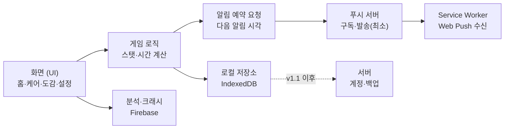

# 가상 펫 키우기 모바일 게임 PRD

작성일 2026-11-08 · 최종 정리 2026-11-13 · 작성자 김용년
프로젝트 가칭: 펫토리(가칭)

---

## 1. 개요

이 제품은 하루 몇 번 짧게 열어 알을 부화시키고 캐릭터를 돌보는 설치형 웹앱(PWA)으로 제공하는 가상 반려 키우기 게임입니다. 앱 마켓에는 올리지 않고 URL로 배포합니다. 프로젝트 가칭은 "펫토리(가칭)"이며, 출시 전 이름과 캐릭터는 모두 독자 창작으로 확정합니다(7장 법적 이슈 참고).

- **한 줄 소개**: 주머니 속 작은 친구를 밥 주고, 놀아주고, 재우며 키우는 90년대 감성의 육성 게임.
- **배경**: 실시간 시간 흐름으로 돌보는 육성 장르는 향수와 힐링 수요가 꾸준합니다. 소규모로 개발 가능한 범위로 MVP를 만들고 반응을 보며 확장합니다.
- **제품 목표**
  1. 첫 실행 3분 안에 알 부화까지 경험
  2. 하루 3~5회 짧은 재방문 습관 형성
  3. 무료로 시작하고, 필수 진행을 막지 않는 가벼운 인앱 구매(v1.2)로 지속 가능한 수익

### 성공 지표 (출시 후 3개월 기준, 초안)

| 지표 | 목표 | 측정 방법 |
| --- | --- | --- |
| D1 리텐션 | 40% 이상 | 분석 SDK 코호트 |
| D7 리텐션 | 15% 이상 | 분석 SDK 코호트 |
| 일 평균 세션 수 | 3회 이상 | 활성 사용자당 |
| 알림 수신 동의율 | 60% 이상 | 첫 실행 후 권한 허용 비율 |
| PWA 설치율 | 30% 이상 (가정) | 설치 안내 노출 대비 홈 화면 추가 비율(추정) |
| 크래시 없는 세션 | 99.5% 이상 | Crashlytics |

목표 수치는 가정이므로 소프트 런칭 데이터로 조정합니다.

---

## 2. 타깃 사용자와 시나리오

주 타깃은 어린 시절 반려 장난감을 기억하는 25~40세 성인이고, 보조 타깃은 가벼운 육성 게임을 찾는 10대입니다.

| 페르소나 | 특징 | 원하는 것 |
| --- | --- | --- |
| 출퇴근 직장인 (30대) | 하루 여러 번 짧게 폰을 봄, 추억의 장난감에 관심 | 1~2분 만에 끝나는 케어, 부담 없는 알림 |
| 학생 (10대) | 가벼운 수집·꾸미기를 좋아함 | 캐릭터 종류와 아이템 다양성, 친구 공유 |
| 복귀 유저 | 여러 일 접속하지 못했다가 돌아옴 | 죽지 않는 부담 없는 복귀 경험 |

### 핵심 시나리오

1. 아침에 알림을 받고 앱을 열어 밥을 주고 현재 상태를 확인한다.
2. 점심에 미니게임으로 놀아주고 행복을 올린다.
3. 저녁에 똥을 치우고 잠자리에 들게 해 하루를 마무리한다.
4. 성장 단계가 바뀔 때 진화 연출을 보고 새 도감 항목이 해금된다.

---

## 3. 범위와 우선순위

MVP는 "알 선택 → 부화 → 케어 → 성장 → 알림"의 한 바퀴를 돌게 하는 것까지입니다. 소셜·결제·다중 캐릭터는 이후 단계로 미룹니다.

| 기능 | 우선순위 | 단계 |
| --- | --- | --- |
| 알 선택·부화 연출 | P0 | MVP |
| 케어 행동 (밥, 간식, 놀아주기, 똥 치우기, 재우기, 약 주기) | P0 | MVP |
| 스탯 감소와 실시간 경과 | P0 | MVP |
| 성장 단계와 진화 분기 | P0 | MVP |
| Web Push 알림 (최소 푸시 서버 포함) | P0 | MVP |
| PWA 설치 유도·오프라인 캐시 | P0 | MVP |
| 미니게임 1종 | P1 | MVP |
| 도감 (진화 수집) | P1 | MVP |
| 사망·환생 규칙 | P1 | MVP |
| 아이템·꾸미기 상점 | P1 | v1.1 |
| 계정 백업·기기 이전 | P1 | v1.1 |
| 웹 결제, 광고 보상 | P2 | v1.2 |
| 친구 방문·선물 소셜 기능 | P2 | v2.0 |
| 위젯, 시계 앱 연동 | P2 | v2.0 |

**MVP 제외**: 실시간 멀티플레이, 서버 기반 랭킹, 타 기기 간 실시간 동기화.

---

## 4. 핵심 게임 시스템

수치는 초기 제안값이며 플레이 테스트로 조정합니다. MVP의 서버는 푸시 알림 전송용 최소 서버뿐이고 게임 상태는 기기에 저장하므로 시간은 기기에 저장된 마지막 시각을 기준으로 계산하고, 시계 조작은 7장의 시간 무결성 규칙으로 막습니다. 서버 시각 기준 판정은 계정 서버가 생기는 v1.1 이후에 검토합니다.

### 스탯

| 스탯 | 범위 | 감소 속도(제안) | 회복 행동 |
| --- | --- | --- | --- |
| 배고픔 | 0~4 | 1칸당 약 3시간 | 밥 +2, 간식 +1 |
| 행복 | 0~4 | 1칸당 약 4시간 | 놀아주기 +1~2 |
| 청결 | 똥 개수 0~3 | 밥 후 일정 시간 뒤 똥 발생 | 똥 치우기 |
| 피로 | 0~4 | 활동 후 증가 | 재우기 (취침 시간대 설정) |
| 건강 | 정상/아픔 | 배고픔·똥 방치 시 발생 | 약 주기 |

### 성장 단계 (제안)

부화 시점을 0으로 한 누적 경과 시간 기준으로 알 → 아기 (부화 직후) → 어린이 (1시간 경과) → 청소년 (1일 경과) → 성체 (3일 경과)로 진행하며, 성체 이후에는 형태를 유지합니다. 7일 시점에는 성체 형태가 확정되는 평가가 이루어집니다. 성체 형태는 성장 기간의 평균 케어 점수로 결정되며 3종 이상으로 분기합니다.

### 시간 흐름 규칙

- 앱을 꺼 두어도 시간은 계속 갑니다. 재접속 시 경과 시간만큼 스탯을 한 번에 계산합니다.
- 취침 시간대(기본 23:00~07:00)에는 스탯 감소를 50%로 둡니다. 이 값은 사용자가 설정에서 바꿉니다.
- 장기 미접속 시에도 스탯은 하한에서 멈추며, 이후의 상태 변화는 아래 사망·환생 규칙을 따릅니다.

### 사망·환생 규칙 (제안)

- 아픔 상태를 24시간 이상 방치하면 캐릭터가 떠납니다. 떠난 캐릭터는 삭제하지 않고 "추억 상자"에 기록(이름, 종, 도달 단계, 함께한 기간)으로 보관합니다.
- 사용자는 새 알로 다시 시작합니다. 추억 상자에 보관된 캐릭터는 도감의 "추억" 탭에서 볼 수 있고, 도달한 형태는 일반 도감 항목으로도 해금된 채 남습니다.
- 이 규칙은 복귀 유저에게 좌절감을 주지 않도록 설계했습니다. 아픔 상태가 시작된 뒤 24시간 동안 앱을 열지 않았다면 복귀 화면(FR-9)에서 "떠났다"는 사실을 부드러운 문구로 안내합니다.

### 세부 수치 규칙 (제안값, 플레이 테스트로 조정)

모든 계산은 UI와 분리된 순수 함수로 구현하고, 마지막 갱신 시각부터 현재까지를 한 번에 시뮬레이션합니다.

**건강과 똥**
- 똥: 밥을 먹이면 약 2시간 뒤, 간식은 약 3시간 뒤에 1개 생기며 최대 3개입니다.
- 아픔 진입: 배고픔 0 상태가 2시간 이상 이어지거나, 똥 3개 상태가 2시간 이상 이어지면 아파집니다. 약을 주면 즉시 정상으로 돌아오고, 약은 하루 2회까지 줄 수 있습니다.

**피로와 재우기**
- 피로는 깨어 있는 4시간마다 +1, 놀아주기 1회마다 +1 오릅니다.
- 재우기는 수면 상태로 들어가며, 수면 중에는 1시간마다 피로가 1 줄고 피로가 0이 되면 자동으로 깹니다. 수면 중에는 다른 케어를 하려면 먼저 깨워야 합니다.
- 설정한 취침 시간대에는 자동으로 수면 상태로 간주하고 피로가 같은 속도로 회복됩니다. 이 시간대의 스탯 감소는 50%입니다.

**놀아주기와 미니게임**
- 놀아주기는 하루 합계 5회까지입니다. 기본 놀아주기는 행복 +1, 미니게임(P1)은 점수 구간에 따라 행복 +0/+1/+2입니다. 둘 다 피로 +1입니다.
- 미니게임 구현 전에도 P0인 놀아주기는 기본 동작으로 완결되어야 합니다.

**케어 점수와 성체 분기**
- 한 시간마다 상태 점수를 샘플링합니다. 점수 = 100 × (0.35 × 배고픔/4 + 0.35 × 행복/4 + 0.15 × (1 − 똥/3) + 0.15 × (1 − 피로/4)), 아픔 상태이면 ×0.5.
- careScore는 부화부터 7일 시점까지의 모든 시간 샘플의 평균입니다. 접속하지 않은 시간도 시뮬레이션으로 포함하므로 방치하면 점수가 낮아지고, 취침 시간대는 제외합니다.
- 7일 시점에 알 종류별로 성체 3종으로 갈립니다: 70점 이상 우수형, 40~69점 보통형, 40점 미만 방치형. 알 3종 × 성체 3종 = 총 9종의 성체가 도감에 들어갑니다.
- 9종의 아트 제작량은 일정에 영향을 주므로 기획·디자인 단계에서 범위를 확정합니다.

---

## 5. 기능 요구사항

화면별로 요구사항(FR)과 수용 기준(AC)을 정의합니다.

| ID | 화면 | 요구사항 | 수용 기준 |
| --- | --- | --- | --- |
| FR-1 | 온보딩 | 첫 실행 시 알 3종 중 하나를 고르고 이름을 짓는다 | 알 선택부터 홈 진입까지 3탭 이하 |
| FR-2 | 부화 | 알을 약 10회 두드리면 부화 연출이 재생된다. 두드리지 않아도 최대 3분 뒤 자동 부화한다 | 연출 5초 이내, 스킵 가능, 첫 실행부터 부화까지 3분 이내 |
| FR-3 | 홈 | 캐릭터, 게이지 3개(배고픔·행복·피로), 상태 아이콘 2개(똥 개수·건강), 케어 버튼이 한 화면에 보인다 | 스탯 변화가 1초 이내 반영 |
| FR-4 | 케어 | 밥·간식·놀아주기·똥 치우기·재우기·약 주기 행동을 수행한다 | 행동 후 해당 스탯이 규칙대로 증감 |
| FR-5 | 미니게임 | 간단한 반응속도 미니게임 1종으로 행복을 올린다 | 놀아주기 하루 5회 한도(기본 놀아주기와 합산), 점수 구간에 따라 행복 +0/+1/+2, 한도 도달 시 안내 문구 표시 |
| FR-6 | 성장 | 단계 조건을 충족하면 진화 연출과 함께 모습이 바뀐다 | 앱 종료 중에 일어난 진화는 다음 실행 시 연출된다 |
| FR-7 | 도감 | 진화한 모습이 도감에 기록되고(알 3종 × 아기·어린이·청소년·성체 3티어 = 18형태, 알 단계 제외), 떠난 캐릭터는 "추억" 탭에 보관된다 | 해금 여부와 획득 날짜가 표시되고, 추억 항목에 이름·도달 단계·함께한 기간이 표시된다 |
| FR-8 | 설정 | 취침 시간·알림 켜기/끄기·사운드·데이터 초기화를 제공한다 | 변경 즉시 저장, 초기화는 확인 팝업 필수 |
| FR-9 | 복귀 | 일정 기간 접속하지 않았을 때 복귀 안내 화면을 보여준다 | 경과 시간과 변화된 스탯을 요약 표시 |

**화면 흐름**: 온보딩 → 부화 → 홈 ↔ (케어 메뉴, 미니게임, 도감, 설정)

화면 시안: 알 선택, 홈, 진화, 도감, 설정 5장 (캔버스 링크는 문서 말미 참고)

---

## 6. 알림과 리텐션, 수익화

알림은 이 게임의 핵심 리텐션 장치지만, 잦으면 삭제로 이어지므로 빈도와 톤을 절제합니다. 웹에는 예약형 로컬 알림이 없어 Web Push를 쓰며, 앱 상태가 바뀔 때마다 기기가 "다음 알림 시각"을 계산해 푸시 서버에 등록하고 서버가 그 시각에 발송합니다. 서버에는 구독 정보와 알림 시각·취침 시간대만 저장하고 캐릭터 이름 등 다른 정보는 보내지 않습니다.

| 알림 종류 | 발송 시점(제안) | 상한 |
| --- | --- | --- |
| 배고픔 | 배고픔 스탯이 1 이하에 도달 | 하루 2회 |
| 똥 발생 | 똥이 2개 이상 쌓임 | 하루 1회 |
| 아픔 경고 | 아픔 상태 진입 | 상태당 1회 |
| 진화 임박 | 단계 전환 직전 | 단계당 1회 |

취침 시간대에는 알림을 보내지 않습니다. 알림 권한은 첫 실행 직후가 아니라 알 부화를 마친 시점에 요청해 동의율을 높입니다. iOS는 홈 화면에 설치한 PWA에서만 푸시를 받을 수 있으므로(iOS 16.4 이상), 부화 직후 설치 안내 → 설치 후 권한 요청 순서로 진행합니다.

### 알림 예약 규칙

- **재계산 시점**: 케어 행동을 할 때, 앱이 백그라운드로 가거나 닫힐 때, 설정이 바뀔 때 기기가 알림 종류별 다음 발송 시각을 다시 계산합니다.
- **서버 전송**: 기기는 알림 종류와 발송 시각만 서버에 보내며, 구독당 예약 목록 전체를 교체하는 방식이라 중복 전송이 있어도 결과가 같습니다. 문구는 고정 템플릿이라 서버에 캐릭터 이름 등을 저장하지 않습니다.
- **취침 시간대 보정**: 발송 시각이 취침 시간대에 걸리면 기상 시각 30분 뒤로 미룹니다.
- **상한**: 서버가 구독별로 하루 발송 횟수를 세어 위 표의 상한을 넘기지 않습니다.
- **중복 방지**: 앱이 열려 있는 동안에는 Service Worker가 알림 표시를 생략합니다.
- **구독 만료**: 발송이 만료 오류로 실패하면 서버가 구독을 삭제하고, 다음 앱 실행 때 기기가 재등록합니다.

**리텐션 장치**: 일일 출석 보상, 도감 수집 진행률, 시즌형 한정 아이템(v1.2 이후).

### 수익화 (제안)

- MVP는 무료, 광고 없이 출시합니다.
- v1.2에서 꾸미기 아이템과 추가 캐릭터를 웹 결제(PG 연동)로 판매합니다. 스토어 수수료는 없지만 결제·환불·영수증 처리를 직접 구현해야 합니다. 필수 진행을 막는 결제는 두지 않습니다.
- 강제 전면 광고는 넣지 않습니다. 만 14세 미만을 포함하므로 보상형 광고는 v1.2에서 가족 정책과 아동 대상 광고 제한을 확인한 뒤 도입 여부를 결정합니다.
- 미성년자 결제 보호를 위해 결제 전 확인 단계를 둡니다.

---

## 7. 비기능 요구사항과 법적 이슈

출시 전 가장 먼저 확정해야 할 것은 이름과 캐릭터입니다. "다마고치"는 반다이의 상표이고 캐릭터 디자인도 저작권의 대상이므로, 서비스 공개는 물론 유사한 이름·외형에도 쓰지 않습니다. 필요하면 상표 검색(KIPRIS)과 변리사 자문을 거칩니다.

| 분류 | 요구사항 |
| --- | --- |
| 성능 | 중급 기기에서 실행 60fps 목표, 재방문(캐시) 기준 콜드 스타트 3초 이내 |
| 용량·배터리 | 첫 로드 번들 크기 목표는 프로토타입에서 측정 후 확정, Service Worker 캐싱, 백그라운드 폴링 없이 저장된 시각으로 계산 |
| 오프라인 | 네트워크 없이 게임 플레이 가능 (기기 내 저장). 알림 구독 등록·갱신만 온라인 필요 |
| 시간 무결성 | 시계를 과거로 돌린 경우: 마지막 저장 시각보다 이른 시각이 감지되면 경과 시간을 0으로 처리. 미래로 돌린 경우: 온라인일 때 푸시 서버 시각과 비교해 편차가 크면 서버 시각을 기준으로 삼음. 시간대·서머타임 변경은 UTC 기준 저장으로 영향을 받지 않게 함 |
| 개인정보 | MVP는 로그인·수집 없이 익명 분석만 사용. 만 14세 미만을 포함하므로 수집 항목 최소화, 법정대리인 동의 절차, 푸시 구독 정보 처리 방침을 공개 전 확정. 스토어 정책은 적용되지 않지만 개인정보 보호법은 동일하게 적용 |
| 접근성 | 스크린 리더 레이블, 색상 대신 모양 병기(색각 이상 대응), 글자 크기는 시스템 설정을 따름 |
| 다국어 | MVP는 한국어, 문자열 외부화로 영어·일본어 확장 준비 |
| 웹 배포 | HTTPS 도메인, 개인정보처리방침·이용약관 페이지, iOS 홈 화면 추가 안내, 지원 브라우저(iOS Safari 16.4+, Android Chrome) 명시 |

이 문서는 법률 자문이 아니므로 상표·저작권·아동 개인정보 사항은 전문가에게 확인하세요.

---

## 8. 기술 스택과 아키텍처

하나의 코드베이스로 PWA를 만들고, 필요하면 나중에 스토어 앱으로도 확장할 수 있는 크로스플랫폼을 선택합니다. **결정: Flutter + Flame, 픽셀 아트** (2026-11-13). 아래 표는 선택 근거로 남깁니다. 배포는 PWA(Flutter Web)이며 앱 마켓에는 올리지 않습니다. Flutter Web은 첫 로드 번들이 크므로 프로토타입 단계에서 번들 크기와 콜드 스타트를 측정하고, 목표를 넘으면 엔진을 재검토합니다(대안: TypeScript + PixiJS).

| 선택지 | 장점 | 단점 | 추천 |
| --- | --- | --- | --- |
| Flutter + Flame | UI 중심 앱에 강함, 2D 게임 가능, 단일 코드베이스 | 복잡한 게임 연출에는 한계 | 제일 적합 |
| Unity | 연출·애니메이션 풍부, 자료 많음 | 앱 용량 큼, 일반 UI 작업은 불편 | 연출 중심이면 선택 |
| 네이티브 2벌 (Kotlin, Swift) | 최고 성능, 플랫폼 기능 활용 | 개발 비용 2배 | 소규모 팀에는 비추천 |

### 개발 공통 구성 (제안)

- 상태·시간 계산은 UI와 분리된 순수 함수 모듈로 두어 단위 테스트를 쉽게 합니다.
- 로컬 저장은 IndexedDB(Hive/Isar 웹 백엔드), 알림은 Web Push(Service Worker)를 씁니다. 알림 발송을 위한 최소 푸시 서버(구독 저장, 다음 알림 시각 발송)를 둡니다.
- 분석과 크래시 리포트는 Firebase Analytics와 Crashlytics를 씁니다.
- 푸시 서버는 Supabase(Edge Functions + 스케줄러) 또는 Firebase Cloud Functions를 고려합니다. v1.1 계정 백업은 같은 서버를 확장합니다.

### 구조도

점선은 v1.1 이후 구성(계정·백업)이고, 실선은 MVP에 포함되는 구성입니다. 푸시 서버는 MVP에 포함됩니다.

### 데이터 모델 (MVP)

| 엔티티 | 주요 필드 |
| --- | --- |
| Pet | id, name, species, stage, birthAt, lastUpdatedAt, careScore |
| PetStats | petId, hunger, happiness, hygiene, fatigue, health |
| PoopState | petId, count, nextSpawnAt |
| CareLog | id, petId, action, at, delta |
| Dex | speciesId, unlockedAt |
| MemoryBox | id, petId, name, species, maxStage, bornAt, leftAt |
| Settings | sleepStart, sleepEnd, notifyEnabled, soundEnabled |
| PushSubscription (서버) | id, endpoint, keys, sleepStart, sleepEnd, sentToday |
| ScheduledPush (서버) | subscriptionId, type, fireAt |

---

## 9. 로드맵, 리스크, 오픈 이슈

### 일정 가정

- **팀**: 1인 개발(기획·클라이언트·푸시 서버 포함) + 외주 픽셀 아트. 주 40시간 풀타임 기준입니다. 파트타임(주 15~20시간)이면 일정이 약 2배가 됩니다.
- **아트 규모**: 알 3종 × (알·아기·어린이·청소년 4단계 + 성체 3종)으로 형태 21종, 형태당 상태 약 5개(기본·먹기·기쁨·아픔·수면)입니다. UI·아이콘·배경은 별도입니다. 외주 납품은 3주차 발주 후 단계별로 받는다고 가정합니다.
- **일정 여유**: 개발 항목마다 예상치에 20% 여유를 포함합니다.

MVP 출시까지 약 18주를 목표로 하고, 단계 사이마다 넘어가기 위한 확인 지점을 둡니다. 이 일정은 위 가정에 따른 제안입니다.

| 단계 | 기간 | 주요 작업 | 다음 단계로 가는 조건 |
| --- | --- | --- | --- |
| 기획·검증 | 1~3주 | 컨셉·캐릭터 확정, 상표 검색, 아트 스타일 가이드, 외주 아트 발주, **기술 스파이크**(Flutter Web 번들·콜드 스타트, iOS PWA Web Push 동작 검증), 14세 미만 개인정보 처리 방침 초안 | 상표·컨셉 확정, 스파이크 결과로 엔진·알림 방식 확정(Go/No-go) |
| 프로토타입 | 4~8주 | 스탯·시간 계산 순수 함수와 단위 테스트, 홈·케어 화면, 부화 연출(임시 아트), IndexedDB 저장, PWA 설치·오프라인 캐시, 시간 가속 디버그 모드 | 한 바퀴 플레이 가능(알→성체를 가속 모드로 확인) |
| MVP 알파 | 9~13주 | 성장·진화·분기, careScore, 푸시 서버와 알림 예약, 도감·추억, 설정, 복귀 화면, 미니게임, 분석 연동, 외주 아트 적용 | 핵심 기능 완성, 알림이 실기기(안드로이드·iOS 설치형)에서 동작 |
| 클로즈드 베타 | 14~16주 | 지인 테스트, 지표 수집, 밸런스 조정, 버그 수정 | 지표 목표 충족 또는 조정 방향 확정 |
| 출시 | 17~18주 | 도메인·호스팅 배포, 개인정보처리방침·이용약관 공개, 소프트 런칭, 지표 확인 | - |

### 외주 아트 납품 계획

| 시점 | 납품물 | 사용하는 단계 |
| --- | --- | --- |
| 3주차 | 아트 스타일 가이드, 알 3종 1차 시안 | 기획·검증 마감 |
| 6~7주차 | 알 3종, 아기·어린이 형태 | 프로토타입 후반 |
| 10주차 | 청소년 형태, UI 아이콘·배경 | 알파 중반 |
| 12주차 | 성체 9종 | 알파 후반 (베타 전 통합) |

납품이 늦어지면 개발은 임시 아트로 진행하고 마지막에 교체합니다. 이를 위해 스프라이트 교체가 코드 변경 없이 가능하도록 에셋 구조를 분리합니다.

### 일정 컷라인 (밀릴 때 줄이는 순서)

1. 미니게임(P1)을 베타 이후로 미룹니다. 기본 놀아주기만으로 출시합니다.
2. 성체 분기를 알 종류와 무관한 3종으로 줄입니다.
3. 추억 탭을 단순 목록으로 줄입니다.
4. 그래도 안 되면 알 종류를 3종에서 1종으로 줄입니다.

### 주요 리스크

| 리스크 | 영향 | 대응 |
| --- | --- | --- |
| 상표·저작권 침해 | 서비스 차단, 삭제 요청 | 독자 이름·캐릭터 사용, 출시 전 상표 검색 |
| 알림 피로로 앱 삭제 | 리텐션 하락 | 빈도 상한, 취침 시간대 무음, 설정에서 끌 수 있게 |
| 사망 규칙이 가혹해 이탈 | 복귀 유저 감소 | 추억 상자와 환생 규칙, 플레이 테스트로 수치 조정 |
| 기기 시계 조작 | 밸런스 붕괴 | 시각 역행 감지(7장), 필요 시 서버 시각 도입 |
| 일정 지연 | 출시 연기 | P2 기능을 과감히 후순위로 |
| iOS PWA 푸시 제약 (설치 필수, 16.4+) | iOS 알림 도달률 저하 | 설치 유도 온보딩, 미설치 시 앱 내 안내 |
| 브라우저 저장소 삭제 | 데이터 소실 | 설치 유도, 기기 이전·백업 기능(v1.1) 앞당기기 검토 |
| Flutter Web 초기 로딩 | 첫 방문 이탈 | 프로토타입에서 측정, 초과 시 엔진 재검토 |
| 스토어 노출 없음 | 유입 부족 | 링크 공유 기능, SNS·커뮤니티 마케팅 |

### 오픈 이슈 (2026-11-13 결정)

- [x] 엔진: **Flutter + Flame** (8장)
- [x] 아트 스타일: **픽셀** (캐릭터 컨셉 자체는 독자 창작으로 별도 확정, 7장 참고)
- [x] 수익 모델: **무료 + 앱 내 웹 결제** (MVP 무료, v1.2에 웹 결제 도입)
- [x] 타깃 연령: **만 14세 미만 포함** → 아래 파급 사항 반영 필요
- [x] 출시 지역: **한국만** (MVP는 한국어, 해외 확장은 소프트 런칭 이후 검토)
- [x] 배포 방식: **PWA, 앱 마켓 미출시** (2026-11-13). URL로 배포하고 홈 화면 설치를 유도
- [x] 알림 방식: **Web Push + 최소 푸시 서버**. 서버에는 구독 정보와 알림 시각만 저장

### 14세 미만 포함에 따른 후속 과제

- 개인정보 수집 시 법정대리인 동의 절차 설계 (개인정보 보호법). MVP는 로그인·수집이 없으므로 "수집 최소화"를 원칙으로 하고, 분석 SDK가 수집하는 항목을 점검한다.
- 웹 배포라 스토어 가족 정책은 적용되지 않지만, 분석 SDK(Firebase)와 푸시 구독 정보가 14세 미만 개인정보 기준에 맞는지 점검한다.
- 웹 결제(v1.2)는 미성년자 결제 보호를 위해 결제 전 확인 단계와 한도 안내를 둔다. 보상형 광고는 아동 대상 광고 제한 때문에 v1.2에서 재검토한다.
- 알림 문구와 리텐션 장치(출석 보상 등)는 과몰입을 유도하지 않는 톤으로 점검한다.
- 만 14세 미만 사용자 연령 확인 방식(나이 선택 화면 등)을 온보딩(FR-1)에 넣을지 결정한다.

---

## 참고 링크

- PRD 문서 (편집 가능): https://claude.ai/artifact/Uuj3vCK3XX4k2kwLr9Ga87
- 화면 시안 캔버스: https://claude.ai/artifact/HDb6WbNoS3bbHrRaXV1ivX
